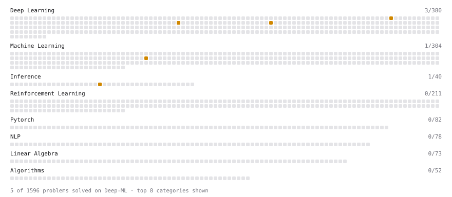

# Deep-ML

My machine learning practice from [Deep-ML](https://www.deep-ml.com). Every solution here was written by hand.

**6** solved · 6 problems · 0 labs · 0 math

[**Browse the interactive portfolio**](https://Wang-Zhongwei.github.io/deep-ml/) to replay this filling in over time.

## Problems

| | Difficulty | Solved | |
| --- | --- | --- | --- |
| [Continuous Batching (In-Flight Batching) Simulator](https://www.deep-ml.com/problems/425) | medium | 2026-10-19 | [solution](problems/0425-continuous-batching-in-flight-batching-simulator) |
| [Implement INT8 Quantization](https://www.deep-ml.com/problems/294) | medium | 2026-10-18 | [solution](problems/0294-implement-int8-quantization) |
| [KV Cache Memory Budget and Eviction Policy](https://www.deep-ml.com/problems/435) | medium | 2026-10-16 | [solution](problems/0435-kv-cache-memory-budget-and-eviction-policy) |
| [KV Cache Tiered Offloading Simulator](https://www.deep-ml.com/problems/436) | medium | 2026-10-17 | [solution](problems/0436-kv-cache-tiered-offloading-simulator) |
| [Preemption Strategies: Swapping vs Recomputation](https://www.deep-ml.com/problems/497) | medium | 2026-09-22 | [solution](problems/0497-preemption-strategies-swapping-vs-recomputation) |
| [Radix Prefix-Tree KV Cache Lookup](https://www.deep-ml.com/problems/1306) | medium | 2026-09-22 | [solution](problems/1306-radix-prefix-tree-kv-cache-lookup) |

---

_This file is regenerated by Deep-ML on every push._
